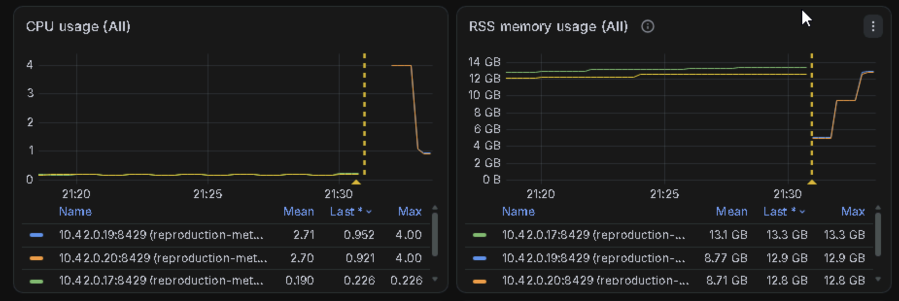
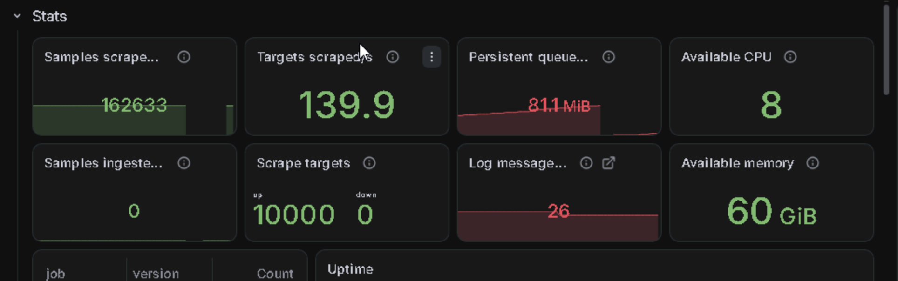
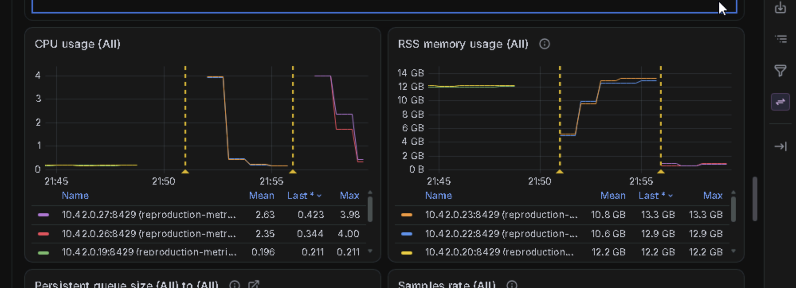
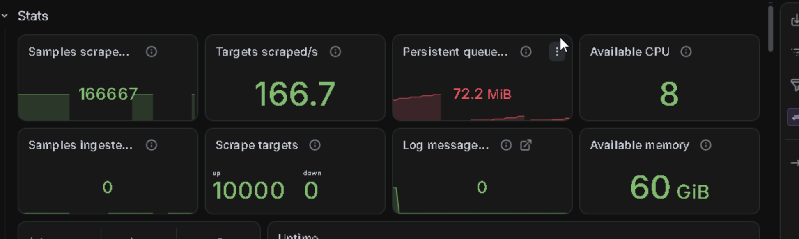

# Reproduction of https://github.com/VictoriaMetrics/VictoriaMetrics/pull/11751

[简体中文](README.zh-cn.md)

This repository uses real Kubernetes objects and native vmagent sharding to reproduce the issue addressed by the [patch](https://github.com/VictoriaMetrics/VictoriaMetrics/pull/11751) and provide comparative validation.

## Architecture and isolation

| Namespace | Resources | Scrape configuration selection |
|---|---|---|
| `reproduction-stack` | Operator, Grafana, VMSingle, monitoring vmagent and cluster collectors | Monitoring vmagent selects ServiceScrapes / NodeScrapes only here |
| `reproduction-monitor` | Subject VMAgent and its metrics Service | Subject selects generated ServiceScrapes in `reproduction-workload` |
| `reproduction-workload` | One metrics Pod, N headless Services and N ServiceMonitors | Each monitor selects one Service and passes its ID |

The Operator converts test ServiceMonitors into VMServiceScrapes. The stack's monitoring vmagent excludes these configurations. The subject's self-monitoring configuration resides in the stack namespace, so its process metrics are still collected.

Jobs share the discovered object set before relabeling and shard assignment; Kubernetes API selectors are explicitly disabled. Each target returns 1,000 samples with fixed labels and random values.

The test uses **10,000 objects, 2 shards × 1 replica**. Subject vmagent limits are **6 CPU / 24Gi per Pod**, and VMSingle limits are **4 CPU / 8Gi**.

## Files

- `namespace.yaml`: the three Namespaces.
- `reproduction.yaml`: workload, self-monitoring and the subject VMAgent (2 shards × 1 replica).
- `values-vm-k8s-stack.yaml`: Helm stack settings and cluster monitoring.
- `reproduction.py`: metrics service script, supplied through `kubectl create cm`.
- `generate.py`: generates N Service / ServiceMonitor pairs.

Helm-rendered resources and generated workload objects remain separate from the static manifest, avoiding duplication of the chart or thousands of repeated resources.

## 1. Environment preparation

Requirements:

- Kubernetes (using K3s as the example)
- Helm 4

Run commands from this repository's root:

```sh
# Prepare K3s
curl -fsSL 'https://raw.githubusercontent.com/k3s-io/k3s/v1.37.1+k3s1/install.sh' -o /tmp/install-k3s.sh
sudo env INSTALL_K3S_VERSION='v1.37.1+k3s1' sh /tmp/install-k3s.sh server --disable traefik --disable servicelb
mkdir -p "$HOME/.kube"
sudo install -m 600 -o "$(id -u)" -g "$(id -g)" /etc/rancher/k3s/k3s.yaml "$HOME/.kube/reproduction.yaml"
export KUBECONFIG="$HOME/.kube/reproduction.yaml"
kubectl wait --for=condition=Ready nodes --all --timeout=300s

# Prepare Helm
curl https://raw.githubusercontent.com/helm/helm/main/scripts/get-helm-4 | bash
```

## 2. Install CRDs and the stack

```sh
mkdir -p generated results
# Install only the Prometheus Operator CRDs
curl -fsSL https://github.com/prometheus-operator/prometheus-operator/releases/download/v0.94.1/stripped-down-crds.yaml -o generated/prometheus-crds.yaml
kubectl apply --server-side -f generated/prometheus-crds.yaml
kubectl wait --for=condition=Established crd/servicemonitors.monitoring.coreos.com --timeout=120s
# Install victoria-metrics-k8s-stack
helm repo add vm https://victoriametrics.github.io/helm-charts/
helm repo update vm
helm upgrade --install reproduction-stack vm/victoria-metrics-k8s-stack --version 0.96.0 -n reproduction-stack --create-namespace -f values-vm-k8s-stack.yaml --wait --timeout=10m
kubectl wait --for=condition=Established crd/vmagents.operator.victoriametrics.com --timeout=120s
kubectl wait --for=condition=Established crd/vmservicescrapes.operator.victoriametrics.com --timeout=120s
```

## 3. Deploy the workload

Apply the namespace manifest, create the script ConfigMap, then deploy the instances. Wait for the workload before generating monitoring objects:

```sh
kubectl apply -f namespace.yaml
kubectl create cm reproduction -n reproduction-workload --from-file=reproduction.py
kubectl apply -f reproduction.yaml
kubectl rollout status deployment/reproduction-workload -n reproduction-workload --timeout=300s
python3 generate.py --count 10000 > generated/workload.json
kubectl apply -f generated/workload.json
# kubectl get services,servicemonitors,vmservicescrapes,endpoints -n reproduction-workload -l reproduction-generated=true
```

Wait for 10,000 Services, ServiceMonitors, converted VMServiceScrapes and Endpoints, each Endpoint with one ready address. Conversion and endpoint reconciliation are asynchronous. Once this full object set exists, restart the subject Pods as shown below so their cold start exercises the full-rebuild path.

## 4. Run and capture the baseline

```sh
# Force a VMAgent restart
kubectl delete pods -n reproduction-monitor -l reproduction-subject=true
kubectl get pods -n reproduction-monitor -l reproduction-subject=true -o wide
```

Wait for both subject Pods to be Ready. Select a Pod and record `promscrape.cluster.memberNum` from its arguments. Run from the K3s node or a machine with a route to the Pod network, and access its Pod IP directly:

```sh
POD='<subject-pod>'
POD_IP=$(kubectl get pod "$POD" -n reproduction-monitor -o jsonpath='{.status.podIP}')
VMAGENT_URL="http://${POD_IP}:8429"
```

Once HTTP `/ready` returns 200, observe for ten minutes before collecting:

```sh
RUN=v1.154.0
curl -fsS "$VMAGENT_URL/config" > "results/$RUN-config.yaml"
curl -fsS "$VMAGENT_URL/metrics" > "results/$RUN-metrics.txt"
curl -fsS "$VMAGENT_URL/api/v1/targets?state=active" > "results/$RUN-targets.json"
curl -fsS "$VMAGENT_URL/debug/pprof/heap?gc=1" > "results/$RUN-heap.pb.gz"
```

## 5. Run the patched version

```sh
PATCHED_REPOSITORY='ghcr.io/camberloid/vmagent'
PATCHED_TAG='v1.154.0-k8s-sparse-0c77a9a35-test'
kubectl patch vmagent reproduction -n reproduction-monitor --type=merge \
  -p "{\"spec\":{\"image\":{\"repository\":\"$PATCHED_REPOSITORY\",\"tag\":\"$PATCHED_TAG\"}}}"
kubectl get pods -n reproduction-monitor -l reproduction-subject=true -o wide
```

Confirm all subject Pods use the patched image and are Ready, and select the replacement Pod for the same shard / replica. Update its Pod IP before collecting the `v1.154.0-fix` data. Do not reapply `reproduction.yaml` during a run: it restores the initial baseline settings.

Collect again:

```sh
POD='<patched-pod-for-the-same-shard>'
POD_IP=$(kubectl get pod "$POD" -n reproduction-monitor -o jsonpath='{.status.podIP}')
VMAGENT_URL="http://${POD_IP}:8429"
RUN=v1.154.0-fix
curl -fsS "$VMAGENT_URL/config" > "results/$RUN-config.yaml"
curl -fsS "$VMAGENT_URL/metrics" > "results/$RUN-metrics.txt"
curl -fsS "$VMAGENT_URL/api/v1/targets?state=active" > "results/$RUN-targets.json"
curl -fsS "$VMAGENT_URL/debug/pprof/heap?gc=1" > "results/$RUN-heap.pb.gz"
```

```sh
diff -u results/v1.154.0-config.yaml results/v1.154.0-fix-config.yaml
go tool pprof -top -sample_index=inuse_objects results/v1.154.0-heap.pb.gz >> results/v1.154.0-heap.inuse_objects.txt
go tool pprof -top -sample_index=inuse_objects results/v1.154.0-fix-heap.pb.gz >> results/v1.154.0-fix-heap.inuse_objects.txt
go tool pprof -top -sample_index=inuse_space results/v1.154.0-heap.pb.gz >> results/v1.154.0-heap.inuse_space.txt
go tool pprof -top -sample_index=inuse_space results/v1.154.0-fix-heap.pb.gz >> results/v1.154.0-fix-heap.inuse_space.txt
go tool pprof -top -sample_index=alloc_space results/v1.154.0-heap.pb.gz >> results/v1.154.0-heap.alloc_space.txt
go tool pprof -top -sample_index=alloc_space results/v1.154.0-fix-heap.pb.gz >> results/v1.154.0-fix-heap.alloc_space.txt
```

`inuse_objects` counts live objects, `inuse_space` measures sampled live heap bytes, and `alloc_space` measures cumulative allocation bytes. `>>` appends reports; clear the corresponding txt before repeating a command to avoid mixing multiple outputs. The conclusions below use the retrieved profiles and metrics, treating object counts, cumulative allocation and RSS as distinct measurements.

## Grafana

Grafana is enabled and exposed through NodePort 30080.

## Cluster monitoring

kubelet/cAdvisor, kube-state-metrics and node-exporter are enabled. Use Grafana **Explore → VictoriaMetrics**:

| View | PromQL |
|---|---|
| Ready subject Pods | `sum(kube_pod_status_ready{namespace="reproduction-monitor",condition="true"})` |
| Subject Pods: total CPU cores | `sum(rate(container_cpu_usage_seconds_total{namespace="reproduction-monitor",container!="",container!="POD"}[5m]))` |
| Subject Pods: total working set GiB | `sum(container_memory_working_set_bytes{namespace="reproduction-monitor",container!="",container!="POD"}) / 1024^3` |
| Subject Pods: requested memory GiB | `sum(kube_pod_container_resource_requests{namespace="reproduction-monitor",resource="memory",unit="byte"}) / 1024^3` |
| Subject Pods: memory limits GiB | `sum(kube_pod_container_resource_limits{namespace="reproduction-monitor",resource="memory",unit="byte"}) / 1024^3` |
| Subject Pods: restarts in 15 minutes | `sum(increase(kube_pod_container_status_restarts_total{namespace="reproduction-monitor"}[15m]))` |
| Subject containers last terminated by OOM | `sum(kube_pod_container_status_last_terminated_reason{namespace="reproduction-monitor",reason="OOMKilled"} == 1)` |
| Cluster: total available node memory GiB | `sum(node_memory_MemAvailable_bytes) / 1024^3` |

The namespace aggregates include every shard, replica and sidecar. Use `sum by (pod)(...)` for per-Pod breakdown. OOM reports the last termination state, not an event count ([metric definitions](https://github.com/kubernetes/kube-state-metrics/blob/v2.20.0/docs/metrics/workload/pod-metrics.md)). Kubernetes Ready does not replace vmagent `/ready`. If metrics are absent, inspect the monitoring agent's `/targets`; an empty result is not zero usage. Keep collectors enabled for both runs.

## Cleanup

Preserve the required results first.

If Kubernetes was deployed specifically for this reproduction, clean up the cluster directly.

```sh
# Applies to the single-node K3s server installed above and deletes the local cluster datastore and local PV data.
sudo /usr/local/bin/k3s-uninstall.sh
```

Otherwise, use the following steps:

Delete VM resources while the Operator still runs, then uninstall the stack and delete the static manifest:

```sh
kubectl delete vmagent reproduction -n reproduction-monitor --ignore-not-found
kubectl delete vmsingle reproduction-stack -n reproduction-stack --ignore-not-found --timeout=600s
helm uninstall reproduction-stack -n reproduction-stack
kubectl delete -f reproduction.yaml --ignore-not-found
```

Namespace deletion also removes generated objects and may delete VMSingle data. K3s and shared CRDs remain installed.

## Results

`./results` contains the latest reproduction results collected by the maintainer in their own environment and is normally ignored by Git.

Use `git add -f results` to include the latest validation results.

### 2026-10-13

Notes:

- The recorded runtime reports four available CPUs per process and a 30 GiB `process_memory_limit_bytes`.
- The processes had been running for approximately 10m13s and 7m04s when sampled.

#### Measurements

These measurements describe **one captured process**. GiB / MiB use powers of 1024. The metrics snapshot and the subsequent forced-GC profile are separate measurement points.

| Metric | v1.154.0 | v1.154.0-fix | Reduction |
|---|---:|---:|---:|
| RSS (metrics snapshot) | 12.703 GiB | 0.728 GiB | 94.27% |
| Go heap alloc (metrics snapshot) | 10.271 GiB | 0.427 GiB | 95.85% |
| Peak RSS over process lifetime | 12.704 GiB | 1.076 GiB | 91.53% |
| Sampled live heap after GC (`inuse_space`) | 7.776 GiB | 0.405 GiB | 94.79% |
| Live allocations directly attributed to the builder closure (flat) | 7539.84 MiB | 0.50 MiB | 99.99% |
| Total sampled live objects (`inuse_objects`) | 3,250,278 | 3,235,121 | — |

In the baseline profile, `getScrapeWorkObjectsByAPIWatcherLocked.func1` accounts for **94.69%** of sampled live heap, compared with **0.12%** after the patch. Object counts remain similar while live bytes decrease substantially, consistent with eliminating retained map capacity for empty results.

Sources: [baseline metrics](results/v1.154.0-metrics.txt), [patched metrics](results/v1.154.0-fix-metrics.txt), [baseline heap](results/v1.154.0-heap.pb.gz), [patched heap](results/v1.154.0-fix-heap.pb.gz). Target equality compares labels and `scrapeUrl`, excluding scrape timestamps, durations and changing sample values.

#### Screenshots and conclusion

This result supports a substantial reduction in memory retained by full Kubernetes target rebuilds while preserving the configuration and the captured shard's target set.

**Baseline: CPU / RSS and target status.**





**Patched: CPU / RSS and target status.** The RSS screenshot retains historical curves from instances running before the switch. The new patched instances are below 1 GB; use the per-process metrics above for exact values. Both status screenshots show 10,000 up targets and zero down targets in the dashboard's aggregate view.




